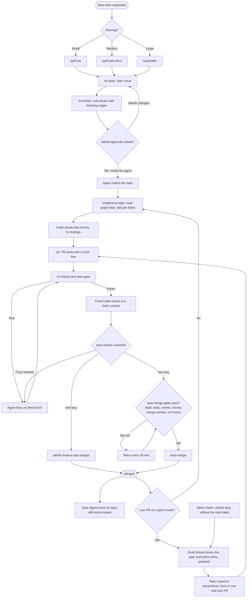

# Development workflow

How a change gets from idea to merged in Ironfront. Agents do the planning, building and reviewing with Matt Pocock's skills (in `.claude/skills/`). da5idt approves the plan and merges risky changes. GitHub Actions run only deterministic checks.

## Steps
1. **Plan.** The agent sizes the work and grills da5idt with `/grill-me`, `/grill-with-docs` or `/wayfinder`.
2. **Spec and tickets.** `/to-spec` writes a spec issue. `/to-tickets` splits it into sub-issues that say which tickets block which.
3. **Approval.** da5idt labels the tickets `ready-for-agent`. Nothing is built before this.
4. **Build.** `/implement-spec` works the ticket graph: up to 4 tickets in parallel, one spec at a time, 60 minutes per run.
5. **Branch review.** `/code-review` checks the branch against `CODING_STANDARDS.md` and the spec, and the agent fixes what it finds.
6. **Pull request.** `/pr` writes the body. Its **Door** line says one-way or two-way, following the door table below.
7. **Checks.** CI and `door-gate` run. `door-gate` labels the PR, and the strictest of the PR body, the final review and `tools/door_gate.py` wins.
8. **Final review.** A fresh agent that never saw the build runs `/code-review` and comments `door-review: two-way` or `door-review: one-way`.
9. **Merge.** da5idt merges one-way doors. Two-way doors auto-merge when every gate passes. Agents never merge.
10. **Retro.** A retro starts by itself, with no offer and no question to da5idt. When a spec's last PR merges, the build thread closes the tickets and the spec, adds the `retro` label to the spec, and runs `/retro` on the spec's threads and PRs. The retro check (a scheduled job) is the safety net: a closed spec without the `retro` label gets its retro there. The retro is saved as `docs/retros/spec-<n>-<slug>.md` with every finding and its status. Fixes the retro is sure of go in the same PR; fixes that are da5idt's call (repo settings, door rules, new dependencies) are listed as candidates. da5idt picks by merging the PR or commenting on it. A retro PR is always one-way.

## Door table
- **Two-way (auto-merge):** new gameplay features, units, buildings and AI behavior; balance and parameter tweaks; bug fixes, tests and refactors inside the game code; docs other than the rules files.
- **One-way (da5idt merges):** CI and GitHub Actions; door rules and `tools/`; `CLAUDE.md`, `CODING_STANDARDS.md`, `docs/agents/`, this file and the vendored skills; deleting any file that exists on `main`; dependency and lockfile changes; build and deploy config; save-game and map file formats; anything that sends data off the player's machine (network, analytics, telemetry); `LICENSE`, `README.md` and third-party assets (art, sound, fonts).

The path and content rules behind this table live in `.github/aihero.yaml`, and `tests/test_door_gate.py` checks them in CI. A PR that touches `docs/retros/` together with a rules file is one-way because of the rules file; a retro file on its own is a doc.

## CI
The `checks` job runs actionlint, compiles the door scripts, runs `tools/check_house_rules.py` (ADR 0002: no clock, DOM or real randomness in `src/sim`, `src/opponent` or `src/game`) and the tests for the scripts in `tools/`. Then it runs the game's own checks on Node 22: `npm run typecheck`, `npm test` and `npm run build`. There is no linter yet (ADR 0001 keeps dependencies few).

## Auto-merge gates
A two-way PR merges only when all of these hold: the `two-way-door` label, `**Door:** two-way` in the body, a `door-review: two-way` comment from da5idt newer than the last commit, all checks green, inside the merge window (any hour, America/Chicago), and no freeze. There is no freeze command; setting the repo variable `MERGE_FREEZE` to `true` pauses all auto-merges. Auto-merge is live: da5idt ended shadow mode on 2026-11-13 by setting the repo variable `AUTO_MERGE_ENABLED` to `true`. Setting it to anything else brings shadow mode back, where a PR that would merge gets the `would-auto-merge` label and da5idt merges it.

## Scheduled jobs
- **auto-merge** (GitHub Actions): every 30 minutes, and on each new PR comment.
- **Hourly pickup** (Claude scheduled task): at :20 past each hour Central, starts the next approved spec (one at a time) from the build step, in a new thread.
- **PR watch** (Claude scheduled task): every 2 hours at :50 Central, fixes failing CI and review comments on agent PRs.
- **Retro check** (Claude scheduled task): every 4 hours at :50 Central (1:50, 5:50, 9:50 and so on, the hours the PR watch skips), runs the retro for the oldest closed spec without the `retro` label. A run with nothing to do resolves its thread.
- **Daily digest** (Claude scheduled task): 7:50 PM Central, opens a `digest` issue only on days with auto-merges.

The Claude tasks sit at :20 and :50 so they never share a 15-minute slot with the auto-merge runs at :00 and :30.

## Where things live
| What | Where |
|---|---|
| Settings (login, window, door rules, caps) | `.github/aihero.yaml` |
| House rules and door table | `CLAUDE.md` |
| Review rules | `CODING_STANDARDS.md` |
| Issue and label conventions | `docs/agents/` |
| Domain terms, decisions | `GLOSSARY.md`, `docs/adr/` (created when first needed) |
| Door and merge scripts | `tools/door_gate.py`, `tools/auto_merge.py` |
| Door rule tests | `tests/test_door_gate.py` |
| House rules a script checks | `tools/check_house_rules.py`, `tests/test_house_rules.py` |
| Retros, one per spec | `docs/retros/` |
| Matt's skills (vendored) | `.claude/skills/`, source in `VENDORED_FROM.txt` |
